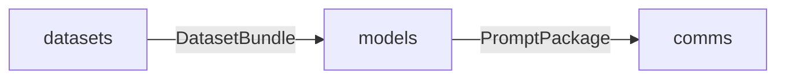

# popbench

用大语言模型做人口模拟的基准。代码分成三层，互不越界：

| 层 | 目录 | 做什么 |
| --- | --- | --- |
| 数据 | `src/popbench/datasets/` | 下载、缓存、读出统一 schema |
| 模拟 | `src/popbench/models/` | 一种人物卡方法一个目录，只生成 persona + 题目输入包 |
| 通信 | `src/popbench/comms/` | 把输入包发给 LLM：provider、重试、磁盘缓存、JSON 解析 |

包名仍叫 `popbench`，避免和 Hugging Face 的 `datasets` 库撞名。命令行入口是 `benchmark`，`popbench` 是同一个程序。



模拟层不导入 `httpx` 或 `cr_api`。通信层不决定人物卡怎么写。

## 数据集

| 注册名 | 目录 | 来源 | 单位 |
| --- | --- | --- | --- |
| `twin2k_500` | `datasets/twin2k_500/` | [LLM-Digital-Twin/Twin-2K-500](https://huggingface.co/datasets/LLM-Digital-Twin/Twin-2K-500) | 真人受访者 |
| `twin2k_mega_study` | `datasets/twin2k_mega_study/` | [Twin-2K-500-Mega-Study](https://huggingface.co/datasets/LLM-Digital-Twin/Twin-2K-500-Mega-Study) | 同一批 pid 上的 19 个后续研究 |
| `simbench` | `datasets/simbench/` | [pitehu/SimBench](https://huggingface.co/datasets/pitehu/SimBench) | **群体分布**，不生成个体 |
| `bdm_lettuce` | `datasets/bdm_lettuce/` | [Gibson & Li, Borealis 10.5683/SP3/CDLUEZ](https://doi.org/10.5683/SP3/CDLUEZ) | 610 名加拿大受访者 |

SimBench 的正式拼写是 SimBench。`SimBechMark` 只在命令行里被认成 `simbench`。每一行是一个群体提示加选项份额（`human_answer`），加载器拒绝带 `pid` 的个体微数据。

Mega-Study 的行只有新问卷和真人答案。人物卡字段在 Twin-2K-500 上，模拟时加 `--attach-twin2k`，按 pid 接上，不另造受访者。

`bdm_lettuce` 是 Gibson 与 Li 的加拿大生菜支付意愿实验（CC-BY 4.0）。别名 `canada_bdm`。每一行是一个 `pid`。人物卡只用 `survey_*` 人口学和消费习惯，不是 Twin-2K 那种长篇叙事。六项 WTP（`local_field`、`local_greenhouse`、`local_vertical`、`nonlocal_field`、`nonlocal_greenhouse`、`nonlocal_vertical`）和可选的 `conclusion_purchased_product` 只放在 `Gold` 上。`benchmark fetch bdm_lettuce` 从 Borealis 把 CSV、README 和问卷 docx 缓存到 `data/bdm_lettuce/`。

缓存写在 `data/`，已在 `.gitignore` 里，不要提交。

## 人物卡方法

| 目录 | 用什么 | 不用于 |
| --- | --- | --- |
| `models/demographics_only/` | 人口学第一块，对应 Mega-Study 的 demographic 变体 | SimBench 群体 |
| `models/full_persona/` | Twin-2K `persona_text` | 群体 |
| `models/persona_summary/` | Twin-2K `persona_summary` | 群体 |
| `models/atus_expanded/` | 在已有人口学（和可选的 ATUS 分钟）上做确定性生活史扩写 | 不会凭空造人，也拒绝 SimBench |
| `models/group_prompt/` | SimBench 公布的群体提示，输出选项分布 | 个体问卷 |
| `models/bdm_survey_persona/` | 加拿大 BDM 调查的人口学和消费习惯 | 不读 WTP 出价，也不用于其他数据集 |

题目的标准答案放在 `Gold` 上。人物卡方法读不到它。

## 安装

需要 Python 3.11 或更新版本。

```bash
python -m venv .venv
source .venv/bin/activate
pip install -e ".[dev]"
```

没有密钥时用 `--provider mock`。要打真实接口，把密钥写进 `.env`（见 `.env.example`）：

- `openai`：`OPENAI_API_KEY` / `OPENAI_BASE_URL`，或 DeepSeek 的 `DEEPSEEK_API_KEY` / `DEEPSEEK_BASE_URL`
- `cr`：`CR_API_KEY`，走仓库里的 `cr_api.CRClient`

## 拉取数据

```bash
benchmark fetch twin2k_500
benchmark fetch twin2k_mega_study --study privacy --limit 20
benchmark fetch simbench --split SimBenchPop --limit 20
benchmark fetch bdm_lettuce
```

`twin2k_500` 读 Hub 上的 `full_persona` 和 `wave_split`。Mega-Study 默认会拉全部 19 个 study，体积大约几百 MB，试跑请加 `--study` 和 `--limit`。SimBench 的 split 是 `SimBenchPop` 和 `SimBenchGrouped`。

也可以：

```bash
python scripts/fetch_datasets.py simbench --split SimBenchPop --limit 20
```

## 最小模拟

用 mock，不访问网络上的模型：

```bash
benchmark fetch twin2k_500 --limit 2
benchmark simulate \
  --dataset twin2k_500 \
  --method demographics_only \
  --provider mock \
  --limit 1 \
  --out runs/minimal
```

结果在 `runs/minimal/responses.jsonl`。同一输入会进 `runs/minimal/cache/`。

SimBench 群体：

```bash
benchmark fetch simbench --split SimBenchPop --limit 5
benchmark simulate \
  --dataset simbench \
  --split SimBenchPop \
  --method group_prompt \
  --provider mock \
  --limit 1
```

Mega-Study 接上 Twin-2K 人物卡后再模拟：

```bash
benchmark fetch twin2k_500 --limit 50
benchmark fetch twin2k_mega_study --study privacy --limit 5
benchmark simulate \
  --dataset twin2k_mega_study \
  --study privacy \
  --method persona_summary \
  --attach-twin2k \
  --provider mock \
  --limit 1
```

加拿大 BDM 生菜支付意愿：

```bash
benchmark fetch bdm_lettuce
benchmark simulate \
  --dataset bdm_lettuce \
  --method bdm_survey_persona \
  --provider mock \
  --limit 1
```

`canada_bdm` 是 `bdm_lettuce` 的别名。

换真实模型时把 `--provider mock` 换成 `openai` 或 `cr`，并用 `--model` 指定模型名。`cr` 的默认模型是 `deepseek-v4-pro`。

## 测试

```bash
pytest
```

测试使用本地夹具和 mock provider，不下载 Hub 数据。

## 这一版删掉了什么

旧的实验入口（ATUS 人群划分、七类题 TVD 对比、jin10 时事拼接、经济切片、访问者访谈）混在取数、提示词和 HTTP 里。它们已从本分支移除，历史仍在 `main`。数据缓存本来就不入库。
