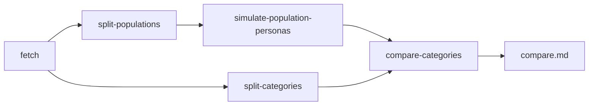

# popbench

给其他项目用的人口模拟基准。主路径是五步：准备 ATUS 与 Twin-2K、两边分组、用已写好的人物卡、按七个论文类别作答、对照 Twin-2K 份额打分。

要比的是：模型拿着人物卡作答之后，答案分布离 Twin-2K 里真人的选项份额有多近。



换作答模型时，人和题不动。写人物卡用的 DeepSeek 和作答用的模型是分开的。

## 安装

需要 Python 3.11 或更新版本。

```bash
python -m venv .venv
source .venv/bin/activate
pip install -e ".[dev]"
```

写人物卡读 `DEEPSEEK_API_KEY` 和 `DEEPSEEK_MODEL`（现为 `deepseek-flash`）。`compare-categories` 的 `--models` 默认是 `gpt-5.5`、`glm-5.3`、`deepseek-v4-pro`，经 `cr_api.CRClient` 调 CR API。把 `CR_API_KEY` 写进 `.env`（见 `.env.example`）。

## 1. 数据介绍

两套数据。

- **ATUS 2023**：活动汇总与复权权重，8382 名成年人。人群划分见 [HumanReadme.md](HumanReadme.md)。
- **Twin-2K-500**：题库按论文七类，闭卷作答 654 道。类别见 [DataReadme.md](DataReadme.md)。

```bash
popbench fetch
popbench fetch --visitors-only
```

`fetch` 缓存 Twin-2K。`--visitors-only` 只缓存 ATUS（以及同一批访问者源文件里的 ACS、普查表）。

## 2. 分组

ATUS 人群：九个因子、27 组。同一成年人可以出现在多组。

```bash
popbench split-populations
popbench build-population-visitors
```

Twin-2K 题目按论文七类切开：`demographics`、`personality`、`cognitive`、`economic`、`heuristics`、`experiments`、`pricing`。

```bash
popbench split-categories
```

## 3. 人物卡

`popbench simulate-population-personas` 为每个成年人写一张卡。人物 id 是 `visitor-atus-{TUCASEID}`，正文在 `data/visitors/by_population/adults/personas.jsonl`。同一个人出现在哪些组里，那些组都复用这一张。写卡的模型是 DeepSeek API（`DEEPSEEK_MODEL`）。

这一步已经写好，不需要重跑。

## 4. 用人物卡回答七类题

`popbench compare-categories` 用上面的人物卡回答七类闭卷题。谁作答仍由 `--n` 和 `--seed` 决定，默认 50 人。人物卡按 `TUCASEID` 从 `adults/personas.jsonl` 读取。找不到文件，或抽中的人没有卡，会提示先跑 `popbench simulate-population-personas`。

七类各开一场访谈，后一类看不到前一类的答案。问卷系统提示用人物卡正文。`--families` 可以只跑其中几类。作答模型由 `--models` 指定，和写人物卡的 DeepSeek 分开。

```bash
popbench compare-categories --n 50 --seed 0
popbench compare-categories --n 50 --seed 0 --families heuristics pricing
```

## 5. 评估

同一条命令按类对照 Twin-2K 第 1–3 波选项份额，写到 `runs/compare/atus-categories-n<n>-seed<seed>/compare.md`。选择题用总变异距离，数值题用均分绝对误差。已经有回答、只想重算时加 `--score-only`。

## 其余命令

下面三条是访问者访谈、twin-2k-50 和 6 道探针。

6 道探针是大五人格每个维度 1 道正向题，加 1 道绿色消费题。同一 `--n` 和 `--seed` 抽出同一批 ATUS 成年人，人物卡同样来自已写好的成年人卡。

```bash
popbench compare --n 50 --seed 0
```

结果在 `runs/compare/atus-twin2k-n<n>-seed<seed>/compare.md`。n=50、seed=0 的一份分析见 [reports/atus-twin2k-n50-seed0-compare.md](reports/atus-twin2k-n50-seed0-compare.md)。

访问者访谈先组装 ACS、普查州和 ATUS 分钟，再做 8 轮访问。`expand_persona` 只在这条路径上扩写经历。

```bash
popbench fetch --visitors-only
popbench build-visitors --n 50 --seed 0
popbench simulate --panel visitors --n 50 --seed 0
popbench evaluate --panel visitors --run runs/visitors-n50-seed0
```

也可以合成一步：`popbench run-visitors --n 50 --seed 0`。人设扩写约定见 [docs/skills/simulate-persona-prompting](docs/skills/simulate-persona-prompting/SKILL.md)。

twin-2k-50 的人数、种子和人物条件写在 `configs/v1.yaml`（`full_twin2k`、`demographics_only` 或 `nemotron_usa`）。

```bash
popbench fetch
popbench run --config configs/v1.yaml
```

分步是 `popbench build`、`popbench simulate --panel nemotron`（或 `twin2k`）、`popbench evaluate`。
